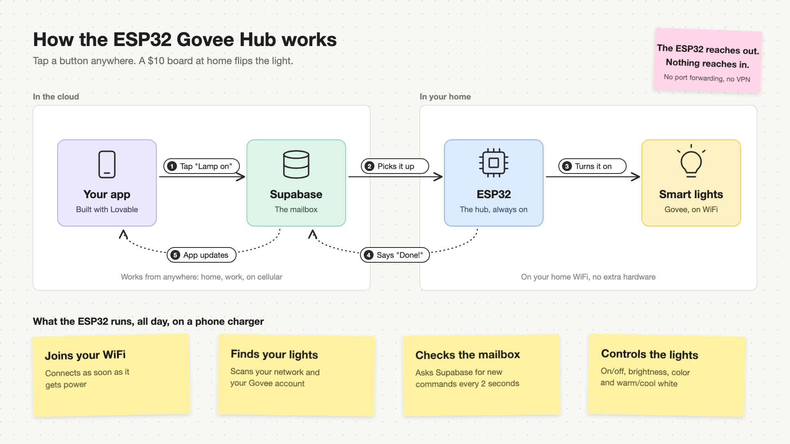

# ESP32 Govee Hub

**A $10 board. Your Govee lights. An app you designed yourself. Set up by your AI agent.**

[](LICENSE)




## The story

I had six Govee lights: two floor lamps, TV light bars, a TV backlight and two kitchen island lights. Controlling
them meant opening the Govee app, waiting, and tapping through each light one at a time. I wanted one place to
control everything, designed the way *I* wanted, that worked from anywhere.

So I plugged a $10 ESP32 board into my laptop and asked an AI agent to find it. A few hours later:

- the board had found every light in the apartment on its own,
- it was switching them instantly over my home WiFi,
- it was serving a control panel to my phone,
- and I was controlling all of it from an app I'd built in [Lovable](https://lovable.dev), from anywhere.

No soldering, no wiring, and I didn't write the code myself. This repo is everything from that afternoon, packaged
so **your** agent can do the same for you.

## Why it's cool

- **Instant.** Lights with Govee's LAN Control react straight away, because commands go over your own WiFi
  instead of a round trip through the cloud.
- **Cheap.** One ESP32 dev board (about $10) and a USB phone charger you already own. That's the whole hub.
- **Your app, your design.** Remix the Lovable template or prompt your own. All on, all off, colors, warm/cool
  white, scenes, a floor plan of your lights: whatever you want.
- **Works without internet.** The board's own control panel keeps working on your home WiFi even when the
  internet is down.
- **Private by design.** The board only makes outgoing requests. Nothing on the internet can reach into your home
  network, and your keys stay on your computer and the board.
- **Always on.** Plug it into a wall charger and forget it. It reconnects on its own after power cuts and WiFi drops.
- **Hackable.** It's a whole computer with WiFi and about 20 free pins. Add a knob, a motion sensor, a sunrise alarm...

## What you need

| Item | Cost | Notes |
|---|---|---|
| Classic ESP32 dev board with USB-C | ~$8-12 | "ESP32 DevKit" / ESP32-WROOM-32, 4 MB flash |
| USB-C cable that carries **data** | you probably have one | Charge-only cables are the #1 reason a board isn't detected |
| USB phone charger | you probably have one | Powers the hub once it's set up |
| Govee WiFi lights | you have these | Bluetooth-only Govee lights won't work |
| Govee API key | free | Govee Home app → Profile → Settings → Apply for API Key |
| Cursor or Claude Code | | Your agent does the setup |
| Lovable account | optional | For the control-from-anywhere app |

Your WiFi needs a **2.4 GHz** network, which nearly every router has.

## Setup in 3 steps

1. **Download** this repo and open the folder in [Cursor](https://cursor.com) or [Claude Code](https://claude.com/claude-code).
2. **Plug** the ESP32 into your computer.
3. **Say:** *"Set up my ESP32 Govee hub."*

Your agent follows [`AGENTS.md`](AGENTS.md). It finds the board, asks for your WiFi and Govee key, flashes the
firmware, checks every light, and puts a control panel on your phone. Then unplug the board, plug it into a
charger anywhere in your home, and you're done.

**Tip:** in the Govee Home app, turn on **LAN Control** for each light that offers it. Those lights become instant.

## Control from anywhere with Lovable

1. **Remix** the template app: **REMIX_LINK_HERE**, publish it, and sign up.
2. Open **Set up your hub** in the app and copy the message it shows to your agent.
3. The agent gives you back a **hub code**. Paste it into the same page and press **Register**.

That's it. Your lights show up in your own app, on your phone, anywhere.

Prefer to design your own app from scratch? Paste [`docs/lovable-app-prompt.md`](docs/lovable-app-prompt.md) into a
new Lovable project.

## How it works

Think of Supabase (the database built into Lovable) as a **mailbox**:

1. You tap "Lamp on" in your app, and the app drops a note in the mailbox.
2. The ESP32 at home checks the mailbox every 2 seconds and picks up the note.
3. It tells the light over your home WiFi, using Govee's LAN API, or Govee's cloud for lights without LAN Control.
4. It writes back "done" plus each light's real state.
5. Your app updates.

Because the ESP32 does the reaching out, you don't need port forwarding, a VPN or any router setup.

## Ideas to build next

- **A real knob.** An [M5Stack Dial](https://shop.m5stack.com/products/m5stack-dial-v1-1) (round screen + rotary
  knob, about $35) as a desk remote: turn for brightness, press for on/off.
- **Motion lights.** A $3 motion sensor so the hallway lights come on when you walk in.
- **Sunrise alarm.** Fade the bedroom lamp up from warm to daylight over 20 minutes.
- **Scenes.** "Movie": TV lights dim, everything else off. "Dinner": warm white at 40%.
- **Music sync.** A small microphone and some beat detection.
- **Other gadgets.** Anything with an API on your network: smart plugs, fans, speakers.

Built something with it? Open an issue with a photo or video. I'd love to see it.

## FAQ

**Do I need to know how to code?** No. Your AI agent runs the setup and explains each step.

**Which lights work?** Govee WiFi lights. Ones with LAN Control are instant; the rest go through Govee's cloud using
your API key.

**Is it safe to leave plugged in?** It runs on 5 V USB and uses about half a watt. Use a decent name-brand charger,
keep the bare board off metal surfaces (a cheap plastic case is ideal), and don't put it inside a wall.

**Can strangers control my lights?** No. The first person to sign up to your app becomes the owner. Everyone else
needs an invite, which the owner sends by email from Settings. Your WiFi password and Govee key stay on the board and
never go to the cloud. The phone panel at `http://govee.local` has no login, though, so anyone on your home WiFi can
use it. Only run the hub on a network you trust.

**What if my internet goes down?** The phone panel on your home WiFi keeps working for lights with LAN Control.
The Lovable app needs the internet.

**I added a new Govee light. How do I get it in?** Unplug the hub and plug it back in. It re-reads your lights
on startup.

**Does it cost anything to run?** The hub checks in every 2 seconds, which fits comfortably in Supabase's free tier.
Lovable has its own plans.

## What's inside

| Path | What's there |
|---|---|
| `src/` | ESP32 firmware (PlatformIO, Arduino framework) |
| `web/` | Phone control panel (React, Vite, Tailwind, shadcn/ui) |
| `supabase/setup.sql` | Database tables and functions shared by the app and the hub |
| `scripts/hub.py` | Setup helper: find board, save settings, flash, monitor, connect to Lovable |
| `AGENTS.md` | Step-by-step runbook for AI agents (humans welcome) |

<details>
<summary>Doing it by hand</summary>

```bash
python3 -m pip install --user -r requirements.txt
python3 scripts/hub.py doctor
python3 scripts/hub.py set WIFI_SSID "..."      # also WIFI_PASSWORD, GOVEE_API_KEY
python3 scripts/hub.py flash
python3 scripts/hub.py upload-web --build
python3 scripts/hub.py monitor --reset --until "Control panel"
```

See [`AGENTS.md`](AGENTS.md) for the full walkthrough and troubleshooting.
</details>

## License

MIT. Remix it, ship it, make a video about it.
